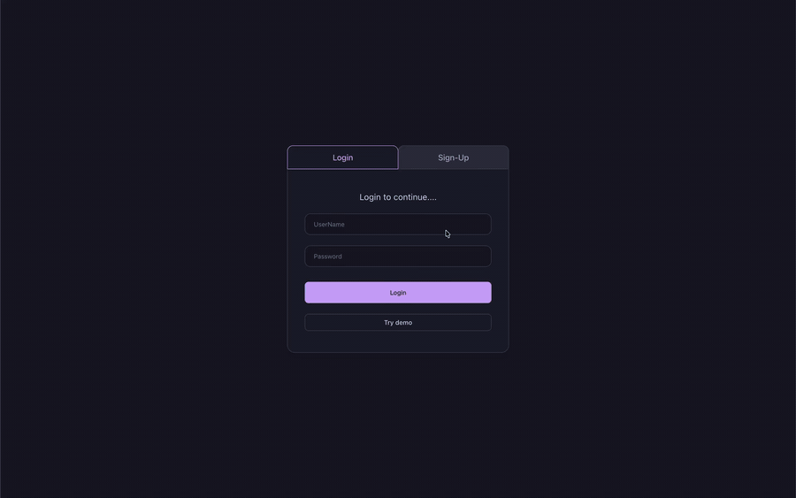

[](https://github.com/AetherO3/Wing/actions/workflows/ci.yml)

# Wing

---

A straight to the point way to get and share opinions on topics, with the design in mind to avoid the groups from becoming echo chambers.

**Live Link:** https://wing-w3ei.onrender.com  
**No signup needed:** click **Try demo** on the login page.



---

### Features

- Sign up, log in, and manage your account.
- Create and join debate groups.
- Threaded messages with a agree or disagree stance.
- Vote on messages (click again to undo, click the other side to switch).
- Search groups by name.
- Demo mode that runs entirely in the browser.

---

### Tech stack

| Layer    | Tools                                                        |
| -------- | ------------------------------------------------------------ |
| Frontend | React 19, TypeScript, Vite, React Router, Axios              |
| Backend  | Java 21, Spring Boot 4, Spring Security, Spring Data JPA     |
| Database | PostgreSQL, schema managed by Flyway migrations              |
| Auth     | JWT (jjwt) in an HttpOnly cookie, BCrypt password hashing    |
| Other    | Bucket4j (rate limiting), springdoc OpenAPI, Spring Actuator |
| Infra    | Docker and Docker Compose, GitHub Actions CI, Render         |

---

### Design decisions

- The JWT is stored in an HttpOnly cookie instead of localStorage, so JavaScript can't read it and an XSS bug can't steal it. The cookie is SameSite=Lax, and Secure in production.
- Login gives the same error for a wrong username and a wrong password, so nobody can use it to find out which usernames exist.
- Login is rate limited with Bucket4j. Each IP gets 20 attempts, then one more every minute. After that the server answers with a 429 and the login form asks the user to try again later.
- Render puts a proxy in front of the app, so I set `forward-headers-strategy: native`. That makes Spring read the real client IP from `X-Forwarded-For`. Without it everyone would share one rate limit.
- The database schema is managed by Flyway migrations. Hibernate only validates it (`ddl-auto: validate`) and never changes the tables.
- Demo mode swaps the Axios request function for one that answers from an in-memory copy of `seed.json`. Nothing is sent to the server, a refresh resets the data, and the Logout button turns into "Exit demo".
- Render builds one image where Spring Boot serves the built React app. `docker-compose.yml` is only for running locally, with separate Postgres, backend and frontend containers.

---

### Run locally

You need Docker.

```bash
cp .env.example .env
docker compose up --build
```

Set `JWT_SECRET` in `.env` first (any long random string). The other values work as they are.

The frontend runs on http://localhost:8000 and the backend on http://localhost:8080. If the backend exits on the first start, run `docker compose up` again. Postgres wasn't ready yet.

---

### Tests and CI

On every push GitHub Actions builds and tests the backend (`./mvnw verify`) and lints and builds the frontend. There are unit tests for the user and message vote services.

---

### Limitations

- Tokens can't be revoked before they expire (1 hour by default).
- The login rate limit is per IP and lives in memory, so it resets when the server restarts. Running more than one instance would need something shared like Redis.
- CSRF protection is turned off. The app relies on SameSite=Lax cookies.
- The free tier sleeps when idle, so the first load can take around 30 seconds.
- `docker-compose.yml` has no Postgres health check, so the backend can fail on the very first start.

---

### What I want to add next

- Token versioning.
- Pagination.
- Integration tests with Testcontainers.
- A Postgres healthcheck in `docker-compose.yml`.
- AI summary of each side of the discussion.
- Group search using pgvector.
